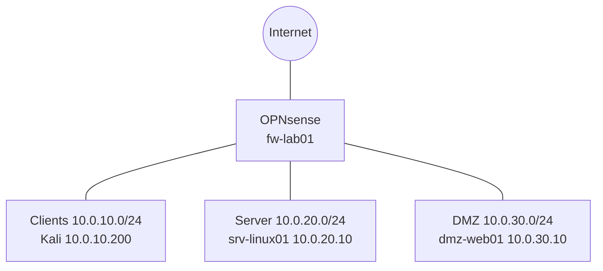

# Secure Network Lab

Segmentiertes Firmennetzwerk in VirtualBox: Eine OPNsense-Firewall trennt Clients, Server und DMZ. Ich baue es, um Netzwerksegmentierung, Firewall-Regeln und Systemhärtung praktisch zu lernen. Monitoring kommt als Nächstes. Mein Ziel ist eine Ausbildung zum Fachinformatiker für Systemintegration mit Schwerpunkt IT-Sicherheit.

## Aufbau

| Segment | Zweck | Netz | Firewall-Adresse |
|---|---|---|---|
| Clients | Arbeitsplätze (Kali Linux als Testrechner) | 10.0.10.0/24 | 10.0.10.1 |
| Server | interne Server | 10.0.20.0/24 | 10.0.20.1 |
| DMZ | extern erreichbare Systeme (Webserver) | 10.0.30.0/24 | 10.0.30.1 |

## Firewall-Regeln

Grundprinzip: Alles ist verboten, nur das Nötige wird freigegeben.

| Von | Nach | Erlaubt | Zweck |
|---|---|---|---|
| Clients | srv-linux01 | TCP 22 | SSH-Administration |
| Clients | Firewall | UDP/TCP 53 | DNS |
| Server | Firewall | ICMP Echo | Erreichbarkeit testen |
| DMZ | Firewall | ICMP Echo | Erreichbarkeit testen |

Die beiden Standardregeln "alles erlaubt" im Clients-Netz (IPv4 und IPv6) sind abgeschaltet.

## Stand

**Fertig**
- OPNsense mit drei Segmenten, DHCP für die Clients
- Firewall-Regeln nach Default Deny, im Log geprüft
- Ubuntu-Server mit SSH nur per Schlüssel, ohne Root-Login
- Webserver (nginx) in der DMZ

**In Arbeit**
- Zugriff der Clients auf den DMZ-Webserver
- Test, dass die DMZ keine Verbindung in andere Segmente aufbauen kann

**Geplant**
- Monitoring mit Wazuh und ein nachgestellter Angriff aus dem Clients-Netz
- Einordnung nach BSI IT-Grundschutz

## Dokumentation

Tagebuch mit Problemen und Lösungen: [`docs/log.md`](docs/log.md)
