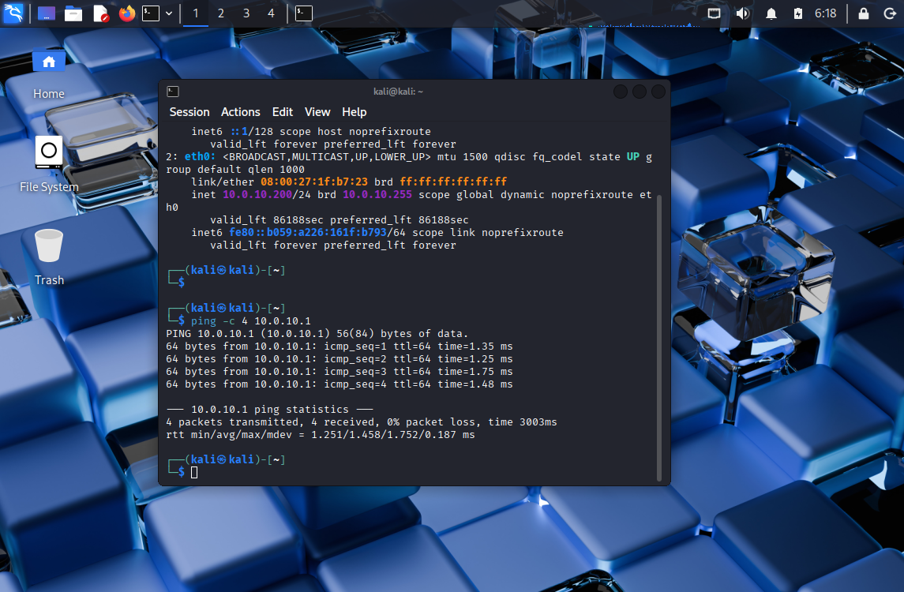
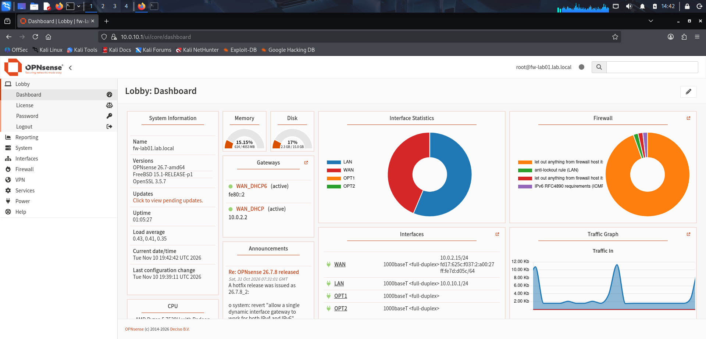

## Tag 1: Firewall und erstes Segment (okt)

**Was ich gemacht habe**
- OPNsense in einer neuen VirtualBox-VM installiert (FreeBSD 64-bit, 4 GB RAM, 2 CPUs, 16 GB Disk) mit vier Netzwerkadaptern: einmal NAT (Internet) und drei interne Netze (Clients, Server, DMZ).
- Interfaces zugewiesen: em0 = WAN, em1 = LAN (Clients), em2 = Server, em3 = DMZ.
- LAN auf 10.0.10.1/24 gesetzt, DHCP für 10.0.10.100 bis 10.0.10.200 aktiviert.
- Kali-VM ins Clients-Netz gehängt. Sie bekam 10.0.10.200 von der Firewall, der Ping auf 10.0.10.1 lief mit 0% packet loss (Screenshot: `screenshots/day1-ip-und-ping.png`).
- Über Kali per HTTPS in die OPNsense-Weboberfläche eingeloggt und den Setup-Wizard gestartet.

**Probleme und Lösungen**
- Bei der Interface-Zuweisung habe ich zu schnell bestätigt und sie wiederholt. Es wird erst nach der letzten Abfrage übernommen.

**Was ich gelernt habe**
- Warum man ein Netz in Segmente teilt und die Firewall dazwischen setzt.
- Was DHCP macht
- Warum private Adressen (10.x.x.x) in vielen Netzen gleichzeitig vorkommen können (NAT).

   

## Tag 2: Server- und DMZ-Segment (10. November)

Ich habe die zwei übrigen Interfaces der Firewall konfiguriert: OPT1 als Server-Segment (10.0.20.1/24) und OPT2 als DMZ (10.0.30.1/24). Beide Adressen sind statisch, damit die Firewall für die Geräte im Segment immer unter derselben Adresse als Gateway erreichbar ist.

Das Dashboard zeigt jetzt alle vier Interfaces mit Adresse, die Dienste laufen.

  

