## Firewall und erstes Segment (okt)

**Was ich gemacht habe**
- OPNsense in einer neuen VirtualBox-VM installiert (FreeBSD 64-bit, 4 GB RAM, 2 CPUs, 16 GB Disk) mit vier Netzwerkadaptern: einmal NAT (Internet) und drei interne Netze (Clients, Server, DMZ).
- Interfaces zugewiesen: em0 = WAN, em1 = LAN (Clients), em2 = Server, em3 = DMZ.
- LAN auf 10.0.10.1/24 gesetzt, DHCP für 10.0.10.100 bis 10.0.10.200 aktiviert.
- Kali-VM ins Clients-Netz gehängt. Sie bekam 10.0.10.200 von der Firewall, der Ping auf 10.0.10.1 lief mit 0% packet loss (Screenshot: `screenshots/day1-ip-und-ping.png`).
- Über Kali per HTTPS in die OPNsense-Weboberfläche eingeloggt und den Setup-Wizard gestartet.

**Probleme und Lösungen**
- Bei der Interface-Zuweisung habe ich zu schnell bestätigt und sie wiederholt. Es wird erst nach der letzten Abfrage übernommen.

**Was ich gelernt habe**
- Warum man ein Netz in Segmente teilt und die Firewall dazwischen setzt.
- Was DHCP macht
- Warum private Adressen (10.x.x.x) in vielen Netzen gleichzeitig vorkommen können (NAT).

## 10./11. November Server- und DMZ-Segment, erste Firewall-Regeln

Ich habe die zwei übrigen Interfaces der Firewall konfiguriert: OPT1 als Server-Segment (10.0.20.1/24) und OPT2 als DMZ (10.0.30.1/24). Beide Adressen sind statisch, damit die Firewall für die Geräte im Segment immer unter derselben Adresse als Gateway erreichbar ist.

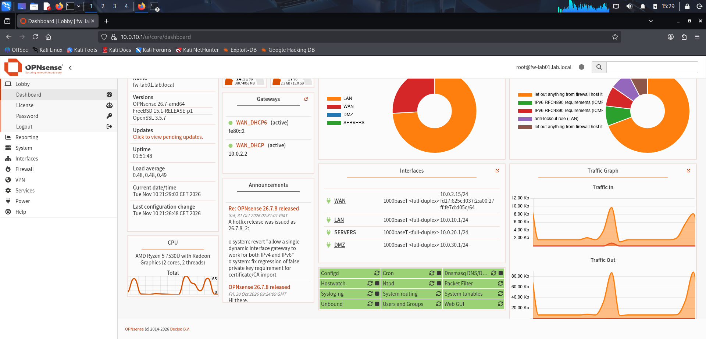

Kali erhält per DHCP die Adresse 10.0.10.200 vom Clients-Segment.

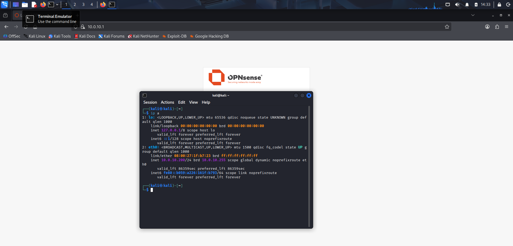

Danach habe ich einen Ubuntu-Server (srv-linux01) installiert, aktualisiert und mit einer festen Adresse (10.0.20.10) ins Server-Segment gehängt. Die Netzwerkkonfiguration (Netplan) ist eine YAML-Datei, bei der die Einrückung entscheidet. Mit `netplan try` habe ich sie getestet, bevor ich sie übernommen habe.

**Default deny in der Praxis:** Der erste Ping vom Server zur Firewall wurde blockiert, weil ein neues Interface keine Freigaben hat. Erst nach einer eigenen Regel (nur ICMP Echo Request, nur zur Firewall-Adresse) kamen Antworten.

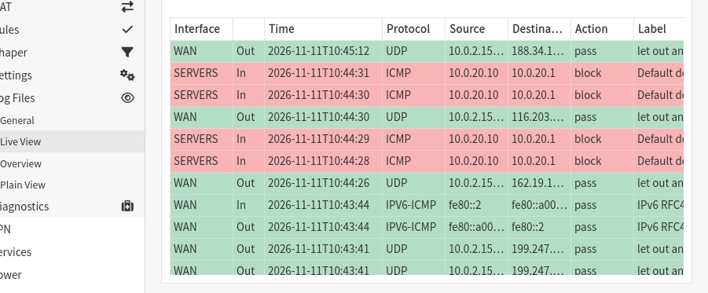
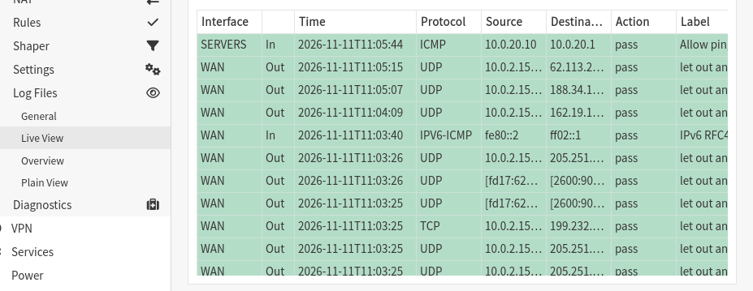

**Zugriff vom Client:** Kali konnte den Server zuerst über die Standardregel "alles erlaubt" im LAN erreichen. Ich habe eine Regel ergänzt, die nur SSH (Port 22) von den Clients zu 10.0.20.10 erlaubt, und die Allow-All-Regel deaktiviert. Danach funktioniert SSH weiter, der Ping zum selben Server wird geblockt.

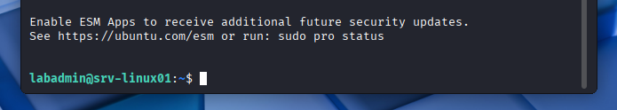
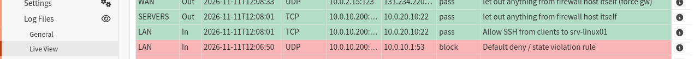

**Bekannte Lücke:** Kali kann jetzt keine DNS-Anfragen mehr an die Firewall stellen, weil dafür noch keine Regel existiert.

## 12. November

**SSH-Härtung auf srv-linux01**

Ich habe auf Kali ein ed25519-Schlüsselpaar erzeugt und den öffentlichen Schlüssel mit `ssh-copy-id` auf den Server kopiert. Danach habe ich Passwort-Login und Root-Login abgeschaltet, aber erst, nachdem der Schlüssel-Login funktioniert hat.

Eine Änderung in `/etc/ssh/sshd_config` allein hätte nichts gebracht, weil `50-cloud-init.conf` `PasswordAuthentication yes` setzt und Vorrang hat. Deshalb habe ich `10-hardening.conf` angelegt. Die Dateien werden alphabetisch gelesen, mein Wert wird also zuerst gefunden.

Getestet habe ich in einer zweiten Sitzung, damit ich mich nicht aussperre. Ein Login mit Passwort wird jetzt mit `Permission denied (publickey)` abgelehnt.

*Kali fragt die Firewall (10.0.10.1) nach example.com und bekommt eine Antwort.*

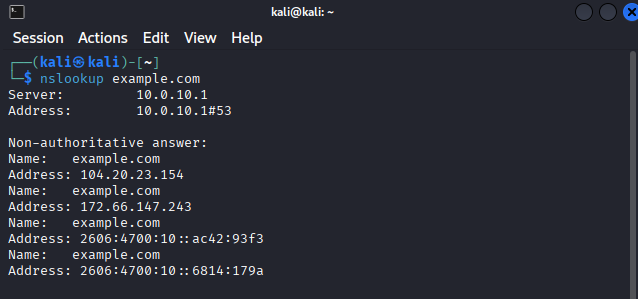

*Login mit Passwort wird abgelehnt (Permission denied, publickey). Nur noch der Schlüssel-Login funktioniert.*

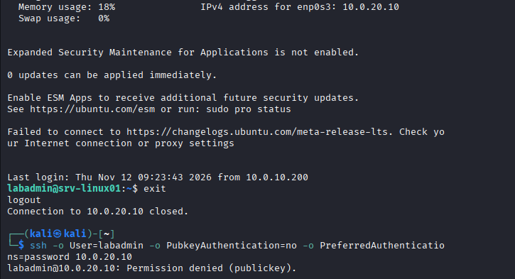

Für die DMZ habe ich meinen Ubuntu-Server geklont und `dmz-web01` genannt. Beim Klonen habe ich neue MAC-Adressen erzeugen lassen, damit es keinen Konflikt gibt. Dann habe ich Hostname und Netplan angepasst (10.0.30.10/24, Gateway 10.0.30.1) und die Netzwerkkarte auf `net-dmz` gestellt.

Der erste Ping zur Firewall wurde geblockt, weil ein neues Interface keine Freigaben hat. Mit einer Regel nur für ICMP Echo zur Firewall-Adresse klappt er.

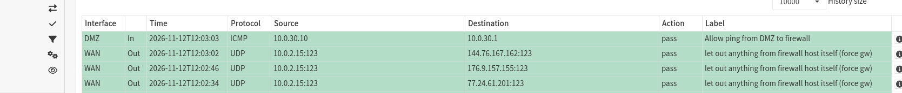

Zum Installieren von nginx hatte die DMZ kurz Internet. Dafür habe ich drei temporäre Regeln angelegt: DNS zur Firewall, HTTP und HTTPS ins Internet. Bei den Web-Regeln habe ich das Ziel invertiert (nicht 10.0.0.0/8), damit die DMZ auch währenddessen nicht an meine internen Netze kommt. Nach der Installation habe ich alle drei wieder deaktiviert. Gelöscht habe ich sie nicht, damit ich sie für spätere Updates wieder einschalten kann.

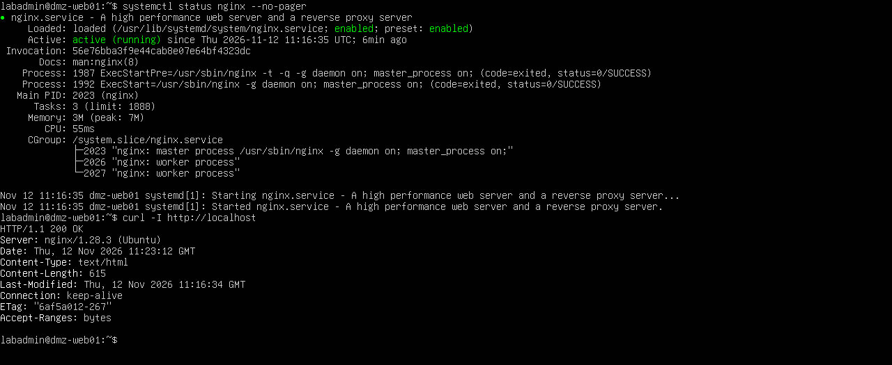

*Die Update-Regeln sind aus. Aus der DMZ gibt es keinen Weg ins Internet mehr.*

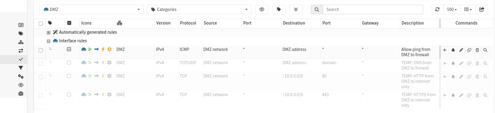
